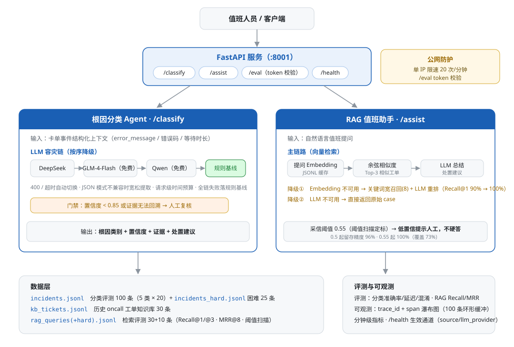
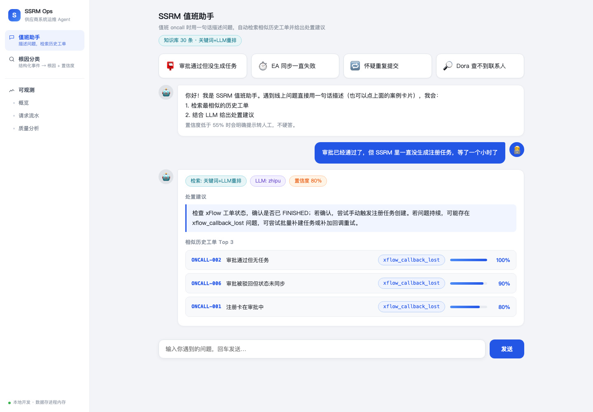
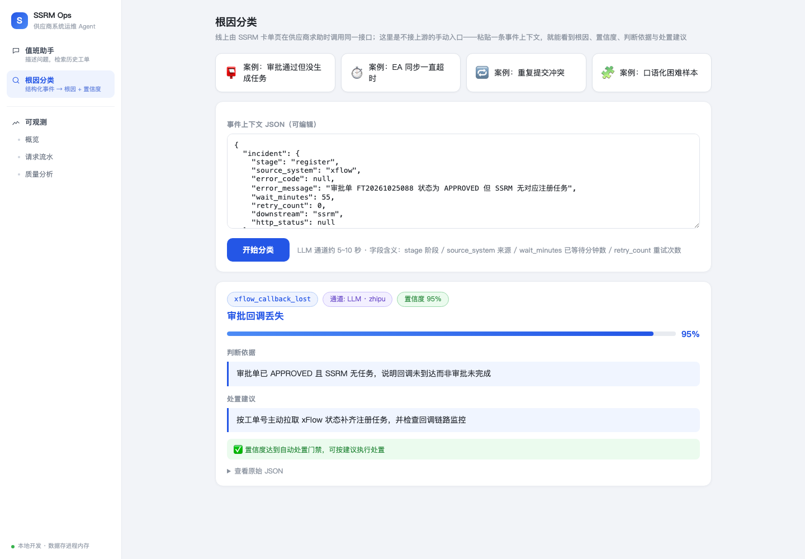
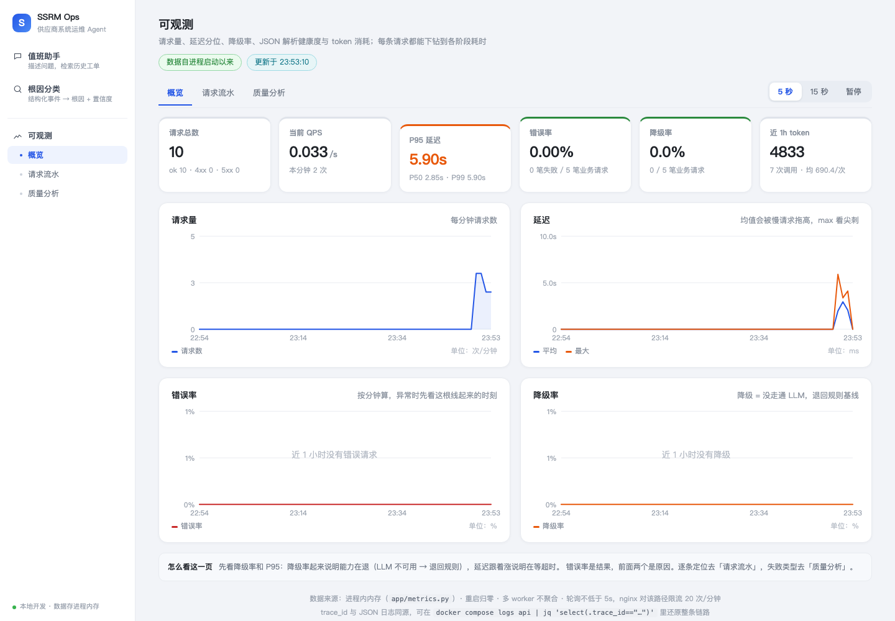
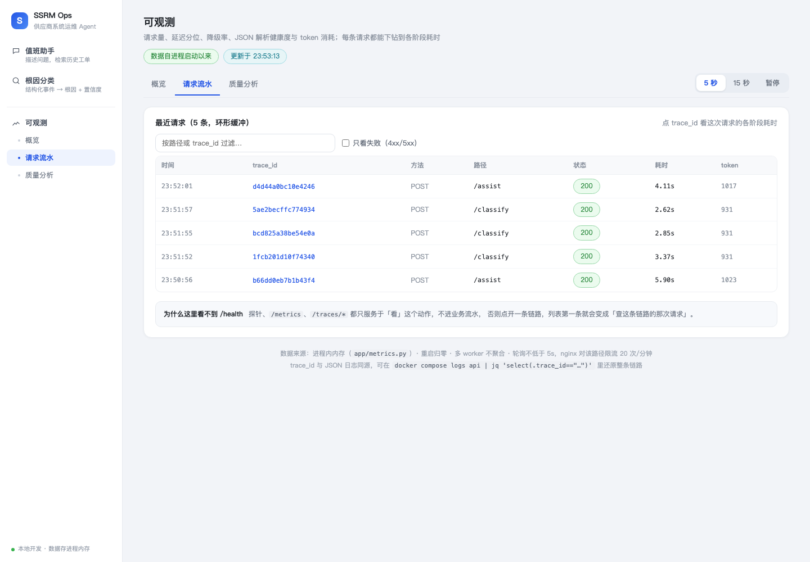

# Agent Gatekeeper — LLM Agent 生产化工程实践（以运维场景落地）

> 这是一套**领域无关的 LLM Agent 生产化骨架**：容灾、预算、门禁、证据回溯、评测回归、全链路可观测。
> SSRM（供应商系统运维）是它的第一个落地场景——选运维是因为它把"输出错了会怎样"暴露得最赤裸：
> 分类错了会触发错误的自动处置，编造了不存在的操作会误导值班。**换一个高风险领域（客服质检、合同审查、
> 诊断分诊），这套骨架照用，换的只是 prompt、分类体系和评测集。**
>
> 项目源自两年供应商系统 oncall 的真实痛点：卡单排查要跨 5 个系统翻日志，同步失败靠人工发现。
> 本项目把这类高频场景做成 Agent：**根因自动分类 + 历史工单检索问答**，全链路可评测、可降级、可部署
> （FastAPI + LLM + RAG）。

## 定位

两个 Agent，一个给机器消费、一个给人消费（**这个"分类器 + 助手"的双 Agent 形态是通用模式，
不是运维专属**——任何"结构化事件判定 + 开放问题解答"组合都适用，如风控可疑交易分类 + 客服坐席助手）：

- **根因分类 Agent**：输入一条卡单/失败事件的**结构化上下文**（告警/对账脚本自动触发），输出**根因类别 + 置信度 + 证据 + 处置建议**——枚举标签可直接驱动自动处置；
- **值班助手 Agent**：输入值班同事的**自然语言提问**，检索相似历史工单后给出**带引用的处置建议**——辅助决策、不编造操作。

5 类根因体系（来自真实 oncall 归因）：

| 类别 | 场景 | 标准处置 |
|---|---|---|
| `xflow_callback_lost` | xFlow 审批已通过但回调未达 SSRM | 按工单号主动拉状态补齐 |
| `ea_sync_timeout` | 向 EA 同步超时/5xx | 异步退避重试 + 对账兜底 |
| `duplicate_submit` | 重复提交/幂等冲突 | 幂等去重，无需人工 |
| `data_inconsistency` | 多下游部分成功的数据缺口 | 对账补推 |
| `frontend_param_error` | 前端/参数错误 | 拒绝并反馈字段问题 |

## 演进：从运维验证域到通用骨架

原名 **ssrm-aiops**。当分类器里的根因体系被抽成可插拔的 Domain Pack、第二个领域（电商客服）零代码改动跑通评测（96.7%）之后，"ops" 已经不足以描述这个项目——它现在是 LLM Agent 的生产化机制层，运维只是第一个验证域，故更名为 **agent-gatekeeper**：项目的差异化正是那一道道"门禁"——置信度门禁、证据可回溯校验、工具白名单三道关、阈值扫描定标。

| 阶段 | 形态 | 里程碑 |
|---|---|---|
| v0.x | `ssrm-aiops` | 源自真实供应商系统 oncall 痛点，定位"智能运维 Agent"，可复现 Demo |
| v1.0 | `agent-gatekeeper` | ① 分类引擎与领域知识分离（Domain Pack）② 通用工具调用层 ③ 第二领域迁移实测 96.7% ④ 可观测三页 + span 瀑布图 + 检索评测 |

> 代码中的环境变量前缀 `SSRM_AIOPS_` 保留未改：改名属于叙事层决策，不值得为它破坏既有部署的 `.env` 兼容性。

## 架构



## 架构要点

1. **多 LLM Provider 容灾链**：`primary(DeepSeek) → zhipu(glm-4-flash 永久免费) → siliconflow(免费 Qwen) → 规则基线`，逐个尝试自动切换；`/health` 暴露当前链路，响应里的 `source` / `llm_provider` 字段可观测实际生效通道
2. **JSON 模式兼容性处理**：部分模型（如 glm-4-flash）不支持 `response_format=json_object`，遇 400 自动降级为宽松 JSON 提取（剥 markdown 围栏 / 平衡花括号截取）
3. **双通道降级**：全链 LLM 失败才回落规则基线，服务可用性不依赖任何外部 LLM
4. **置信度门禁 + 证据可回溯校验**：低于 0.85 标记 `needs_human_review`；evidence 中的锚点必须在输入原文找得到，找不到就压置信度转人工——模型自报 confidence 不可信，但"理由能不能对上输入"是白盒可验证的
5. **请求级时间预算**：总预算按 Provider 切时间片，预算耗尽即降级；与 per-try 超时、nginx 网关超时三层对齐，避免上游先掐断
6. **全链路可观测**：每个请求发 trace_id，进程内 span 埋点（classify / rag.retrieve / rag.rerank / llm.try）画成瀑布图；分钟级指标（请求量/延迟分位/错误率/降级率/按 Provider token 归因）+ 最近 100 条链路，React 面板三页展示（概览/请求流水/质量分析）
7. **评测内建**：根因分类有 `/eval` 端点 + 命令行脚本（常规集 100 条 + 困难集 25 条，准确率/延迟/混淆样例/规则基线对照）；RAG 检索有独立评测（Recall@1/@3、MRR@8、采信阈值扫描），检索通道选择和阈值均有数字依据
8. **引擎与领域知识分离（Domain Pack）**：分类引擎只管机制（通道/门禁/校验），类别定义、few-shot、规则基线都是可插拔的领域包（`app/domains/ssrm`、`csa`、`credit`）——第二领域（客服）LLM 通道 96.7%；第三领域（信贷进件风险分类）反向验证了通道编排的重要性：小模型跑硬阈值领域仅 60~67%，引擎因此支持 **rule_first 规则先行**——规则直判（300 条明确区 100%）、灰区（dti 0.6~0.7 边界带）才升级 LLM 仲裁，仲裁结论仍过证据/置信度双门禁（实测判错的仲裁被证据门禁拦下转人工）；助手侧同样 Pack 化（AssistantSpec）：同一 RAG 引擎挂三份领域知识库，**三域均为完整「分类 + 助手」双 Agent 结构**（运维值班助手 / 电商坐席助手 / 信贷催员辅助，后者即 JD 语境的「催员辅助 Agent」）
9. **通用工具调用层**：tool registry + LLM JSON mode 选工具 + 白名单/schema/置信度三道关（不用 Function Call/LangChain 的理由见 T5-00 文档）；内置 3 个只读工具，端点 `GET /tools`、`POST /tools/ask`
10. **公网防护**：`/classify` `/assist` `/tools/ask` 单 IP 滑动窗口限速（20 次/分钟）；`/eval` 因单次请求会循环调用 LLM，要求 token 校验（`.env` 配置 `SSRM_AIOPS_EVAL_TOKEN`）

> 设计取舍的完整推演（为什么分类不用 RAG、unknown 治理闭环等）见 [docs/design-decisions.md](docs/design-decisions.md)。

## 页面演示

在线体验（LLM 响应约 3~6 秒）：左侧栏三个入口 —— 值班助手 / 根因分类 / 可观测

- 值班助手：`/assistant`（加 `?demo=1` 自动运行预设问题）
- 根因分类：`/playground`（加 `?demo=1` 自动运行预设案例）
- 可观测：`/observability` 概览 · `/observability/requests` 请求流水 · `/observability/quality` 质量分析

**值班助手**——自然语言提问 → 相似工单检索 + LLM 处置建议（置信度分级、相似度进度条）：



**根因分类**——结构化事件上下文 → 根因类别 + 置信度 + 判断依据 + 处置建议：



**可观测概览**——请求量 / 延迟分位 / 错误率 / 降级率 / token，按分钟出趋势：



**请求流水**——每条请求带 trace_id，点开是各阶段耗时的瀑布图（http → assist → rag.retrieve → llm.try）：



## RAG 值班助手

30 条历史 oncall 工单知识库（`data/kb_tickets.jsonl`），值班提问 → 检索相似工单 → LLM 总结处置建议：

- **向量检索优先 + 混合排序**：embedding-2 向量化 + 余弦 Top-K 与字符 bigram Top-K 做 **RRF（k=60）融合排序**（两路信号互补：向量强在同义改写、字符强在专名/错误码），JSONL 持久化缓存按知识库内容 hash 失效（T4-5），二次启动免重复调用
- **降级链路**：embedding 不可用（免费档余额限制）→ 关键词宽召回(8) + LLM 重排序取 Top-3（重排只换序不改分，分数保持可解释的字符覆盖率，T4-6）；LLM 不可用 → 直接返回原始 case；启动预热失败不阻塞服务（`asyncio.wait_for` 包住，超时直接进降级模式）
- **采信阈值**：任一可信信号（余弦 / 字符覆盖率）低于阈值即提示人工判断，不硬答——三域阈值 0.4 / 0.3 / 0.2 不是拍的，是各自在检索评测集上扫描定标的（旧 ssrm 单域口径 0.55：0.5 起留存精度掉到 96%，0.55 起回到 100%，代价是 27% 查询转「建议人工」）
- **检索评测**（`python -m app.evaluation.rag_eval [--domain csa|credit]`）：三域检索评测集共 230 条查询，**strict / cluster 双口径**（同现象簇即命中 vs 精确命中）。实测（关键词召回，bigram 打分）：ssrm 常规 strict 97.3% / 簇级 99.3%，csa 100%，credit 85%（R@3 95%）。扩容曾暴露 unigram 打分簇内区分崩塌（26%），换 bigram + 查询派生改进后恢复——完整调优链路见 T5-01。三域采信阈值各自扫描定标（0.4 / 0.3 / 0.2）
- **检索规模 benchmark**（`python -m scripts.vector_bench`，`--pipeline` 测真实工单扩充）：余弦内核 1 万条 p50 0.91ms（对比 LLM 调用 p95 ≈ 4200ms 占比 <0.2%）；实测先到的瓶颈是纯 Python 关键词召回（1 万条 28ms）而非余弦——十万条级才需换结构，且第一刀优化是关键词扫描不是向量库
- **可视化页面**：`/assistant` 聊天式问答、预设问题、置信度分级着色、相似工单表格、模式/通道徽标

页面入口（左侧栏）：`/assistant`（值班助手）· `/playground`（根因分类）· `/observability`（可观测，含概览/流水/质量三个子页）

## 快速开始

**方式一：Docker 一键起（推荐）**

```bash
cp .env.example .env      # 填入任一 Provider 的 Key（不配置则自动走规则基线）
docker compose up -d --build

# 前端（React）：http://localhost:8001
# 后端（Swagger）：http://127.0.0.1:8002/docs   仅本机可访问
```

`api`（FastAPI）+ `web`（React/nginx）两个服务，`web` 等 `api` 健康检查通过后才启动，避免首屏 502。

**方式二：本地开发**

```bash
pip install -r requirements.txt
python -m uvicorn app.main:app --port 8001        # 后端 8001

cd frontend && npm install && npm run dev          # 前端 5173（/api 自动代理到 8001）

python -m app.evaluation.eval 30                   # 分类评测
python -m app.evaluation.rag_eval                  # RAG 检索评测
```

> 容器化与前端改造的完整步骤、踩坑记录、以及每一步的验收标准见 [docs/PORTING.md](docs/PORTING.md)。

## 数据集

数据按领域分目录：`data/ssrm/`（运维值班）、`data/csa/`（电商客服）、`data/credit/`（信贷风控），与 `app/domains/` 领域包一一对应。每个文件的命名含义、schema 与数据量评估详见 [docs/data-catalog.md](docs/data-catalog.md)。

**SSRM（运维值班）**

| 文件 | 内容 | 用途 |
|---|---|---|
| `data/ssrm/incidents.jsonl` | 100 条合成事件（5 类 × 20），字段模拟真实工单上下文 | 分类常规评测（回归防线） |
| `data/ssrm/incidents_hard.jsonl` | 25 条困难事件：改写表述、无 error_code、口语化描述 | 检验 LLM 相对规则基线的泛化差距 |
| `data/ssrm/kb_tickets.jsonl` | 150 条历史 oncall 工单（30 手工 + 120 变体；现象/根因/处置） | SSRM 值班助手知识库；生成器 `scripts/gen_assistant_data.py` 固定种子 |
| `data/ssrm/rag_queries.jsonl` | 150 条值班口吻提问（对 symptom 改写） | SSRM 检索评测（查询 → 应命中条目/簇） |
| `data/ssrm/rag_queries_hard.jsonl` | 130 条（10 手工 + 120 变体）去黑话/口语化提问 | 打关键词召回的语义鸿沟 |
| `data/ssrm/regression.jsonl` | 20 条手工回归集（5 类 × 4，含 2 条证据门禁探针） | prompt 版本对比的尺子，`make eval` 跑它 |

**CSA（电商客服）**

| 文件 | 内容 | 用途 |
|---|---|---|
| `data/csa/csa_tickets.jsonl` | 150 条电商客服工单（30 手工 + 120 合成） | 分类评测，规则 100%；生成器 `scripts/gen_csa_dataset.py` |
| `data/csa/csa_agent_kb.jsonl` | 100 条坐席助手 SOP/话术 | CSA 助手知识库（话术红线内置） |
| `data/csa/csa_kb_queries.jsonl` | 40 条坐席助手检索评测 | 检索评测 |

**CREDIT（信贷风控）**

| 文件 | 内容 | 用途 |
|---|---|---|
| `data/credit/credit_applications.jsonl` | 300 条信贷进件（30 手工金样本 + 270 参数化合成，5 类 × 60，含 9 条灰区带） | 分类评测：规则先行 + 灰区 LLM 仲裁；生成器 `scripts/gen_credit_dataset.py` 固定种子可复现 |
| `data/credit/credit_collection_kb.jsonl` | 120 条催员辅助话术（5 类 × 24，含合规红线） | CREDIT 助手知识库：早期提醒/承诺跟进/困难协商/失联找回/合规红线 |
| `data/credit/credit_kb_queries.jsonl` | 40 条催员辅助检索评测 | 检索评测 |

生成脚本：`scripts/gen_dataset.py` / `gen_hard_dataset.py` / `gen_kb.py`（固定随机种子，可复现）。

> ⚠️ 已知局限：合成数据与规则基线同源（模板生成），规则基线在常规集上准确率偏乐观（100%）——常规集定位是**回归评测**（防改动退化、通道对照），区分能力靠困难集；生产化路径见 [docs/optimization/T3-00-rag-retrieval-eval.md](docs/optimization/T3-00-rag-retrieval-eval.md) 的"已知边界"。

## 评测

```bash
make eval      # 回归集（20 条手工，含证据探针）+ 困难集，分数按 prompt 版本归档
make eval-rag  # 三域检索评测（调 LLM 重排）
make calibrate # 证据判据标定（纯本地，不调 LLM）
make prompts   # prompts/ 自检（active 指针 / 文件 / 占位符声明）

python -m app.evaluation.eval            # SSRM 分类常规集（LLM 通道）
python -m app.evaluation.eval --regression --record  # 回归集，分数写入 prompts/scores.json
python -m app.evaluation.eval --regression --prompt-version=v1  # A/B：用 v1 prompt 跑同一批样本
python -m app.evaluation.eval 30 --hard  # 分类困难集
python -m app.evaluation.eval 30 --rule  # 规则基线对照
python -m app.evaluation.eval 30 --domain csa       # 电商客服领域（同引擎换包）
python -m app.evaluation.eval 30 --domain csa --rule
python -m app.evaluation.eval 30 --domain credit    # 信贷进件风险分类（规则先行+灰区仲裁）
python -m app.evaluation.eval 30 --domain credit --rule

python -m app.evaluation.rag_eval        # SSRM 检索评测（离线，秒出）
python -m app.evaluation.rag_eval --domain csa    # 坐席助手域
python -m app.evaluation.rag_eval --domain credit # 催员辅助域
python -m app.evaluation.rag_eval --rerank   # 对齐线上降级模式（调 LLM）
python -m app.evaluation.rag_eval --sweep    # 采信阈值扫描表
```

**Prompt 版本化**（[docs/optimization/T3-01](docs/optimization/T3-01-prompt-versioning.md)）：三处 prompt 都在 `prompts/`（`index.json` 的 `active` 指针选版本），服务启动时校验「声明的占位符 == 文本实际占位符」，不一致直接启动失败；`/health` 暴露当前三版本，`/classify`、`/assist` 结果自带 `prompt_version`。

**证据校验**（[docs/optimization/T3-02](docs/optimization/T3-02-evidence-refs.md)）：`root_cause.v2` 要求模型输出 `evidence_refs`（字段 + 值），门禁校验「字段存在吗、值相等吗」，得分与文本长短无关；模型不按 schema 输出时回退 v1 的字面匹配。`/classify` 返回逐条引用明细（`ok` / `actual`），前端渲染成可复核的引用条。v2 基线：回归 0.95 / 困难 0.96（[分数表](prompts/scores.json)）。

## 目录结构

```
agent-gatekeeper/
├── app/
│   ├── main.py          # FastAPI 入口（路由组装 + lifespan）
│   ├── config.py        # pydantic-settings 配置（SSRM_AIOPS_ 前缀，全局唯一顶层配置）
│   ├── pages_legacy.py  # 旧服务端渲染页面（直连后端时兜底）
│   ├── core/            # 基础设施（与业务无关）
│   │   ├── llm_client.py    # LLM 容灾链（多 Provider 依序降级 / JSON 模式兼容 / token 统计）
│   │   ├── budget.py        # 请求级时间预算（按 Provider 切时间片）
│   │   ├── tools.py         # 通用工具调用层（registry + LLM 选工具 + 三道关）
│   │   └── builtin_tools.py # 内置只读工具（KB 统计 / 事件查询 / 系统拓扑）
│   │   ├── embeddings.py    # embedding 客户端（配额耗尽识别，不重试）
│   │   └── vector_store.py  # 内存向量存储（接口对齐向量库，可无缝替换）
│   ├── agents/          # 业务 Agent
│   │   ├── classifier.py    # 根因分类引擎（领域无关：通道编排 + 双门禁，知识由 pack 注入）
│   │   ├── rag_assistant.py # RAG 值班助手（检索 + 降级链路，给人消费）
│   │   └── evidence.py      # 证据可回溯度打分（证据门禁用）
│   ├── observability/   # 可观测
│   │   ├── obs.py           # FastAPI 中间件（trace_id + 访问记录）+ 日志初始化
│   │   ├── metrics.py       # 指标聚合（分位数/分钟时序/请求流水/分类分布）
│   │   └── tracing.py       # 进程内 span 采集（埋点 → 瀑布图）
│   ├── domains/         # 领域包（分类引擎 + 助手的知识插件）
│   │   ├── ssrm/            # 供应商运维领域：taxonomy / rules / pack
│   │   ├── csa/             # 电商客服领域（第二实例，证明可迁移）
│   │   └── credit/          # 信贷域：进件风险分类（rule_first）+ 催员辅助知识库
│   └── evaluation/      # 评测
│       ├── dataset.py       # 数据集加载
│       ├── eval.py          # 分类评测（python -m app.evaluation.eval，支持 --domain）
│       └── rag_eval.py      # RAG 检索评测（python -m app.evaluation.rag_eval）
├── frontend/          # React 前端（Vite + react-router）
│   ├── src/components/Layout.jsx  # 左侧栏外框
│   ├── src/pages/     # Playground / Assistant / Observability(壳)
│   ├── src/pages/observability/   # 概览 · 请求流水 · 质量分析
│   ├── src/observability/         # 共享 metrics context + 链路抽屉 + 格式化
│   ├── src/api.js     # 统一请求层，错误归一化
│   ├── Dockerfile     # 多阶段构建 → nginx 托管
│   └── nginx.conf     # /api 反代 + SPA 路由回退 + gzip
├── Dockerfile         # 后端镜像（非 root、HEALTHCHECK、分层缓存）
├── docker-compose.yml # api + web 一键起
├── data/              # 评测集与知识库，按领域分目录（ssrm/ csa/ credit/，见「数据集」一节）
├── prompts/           # prompt 模板（index.json 定 active 版本，启动校验，见「评测」一节）
├── docs/               # 架构图 + 页面截图 + 改造文档（optimization/）+ 设计决策（design-decisions.md）
├── scripts/            # 数据集生成脚本（固定种子可复现）
├── Makefile            # make eval / eval-rag / prompts
├── .env.example
└── requirements.txt
```
